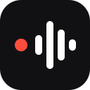

<p align="center"></p>

# @silver/audio-visualiser

A small canvas visualiser for live microphone audio. It shows what your app is doing (idle,
connecting, recording, processing, done or error) and moves smoothly between those states. Use it
as the indicator next to a record or dictation button.

- Six looks: `timeline`, `pill`, `spectrum`, `line`, `orb`, `radial`.
- Works in any framework. A React component and hook ship in `@silver/audio-visualiser/react`.
- Themed with CSS: `color` sets the ink and `--av-accent` sets the accent.
- Sharp on high-DPI screens, and accessible: it sets `role="img"` and an `aria-label`. It respects
  reduced motion.

```sh
npm install @silver/audio-visualiser
```

## React

```tsx
import { AudioVisualiser, microphoneVisualState, useMicrophone } from "@silver/audio-visualiser/react";

export function RecordButton() {
  const mic = useMicrophone();
  const live = mic.status === "live";

  return (
    <button type="button" onClick={() => (live ? mic.stop() : mic.start())}>
      <AudioVisualiser
        variant="pill"
        stream={mic.stream}
        state={microphoneVisualState(mic)}
        style={{ width: 64, height: 24 }}
      />
      {live ? "Stop" : "Record"}
    </button>
  );
}
```

To show that your app is working on the recording, pass any state yourself:

```tsx
<AudioVisualiser variant="orb" state="processing" style={{ width: 96, height: 96 }} />
```

## Vanilla

```ts
import { createMicrophone, createVisualiser, microphoneVisualState } from "@silver/audio-visualiser";

const mic = createMicrophone();
const vis = createVisualiser(canvas, { variant: "spectrum" });

const unsubscribe = mic.subscribe((snap) =>
  vis.update({ variant: "spectrum", stream: snap.stream, state: microphoneVisualState(snap) }),
);

startButton.onclick = () => mic.start();
stopButton.onclick = () => mic.stop();

// cleanup
unsubscribe();
mic.stop();
vis.destroy();
```

`update()` replaces every option, so pass `variant` each time.

## Theming

The canvas gets a `data-state` attribute, so each state can be styled:

```css
.recorder { color: #1c1c1e; --av-accent: #0a84ff; }
.recorder[data-state="recording"] { --av-accent: #ff3b30; }
.recorder[data-state="error"] { color: #d70015; }
```

Size the canvas with CSS. The visualiser handles the pixel ratio.

## Development

```sh
pnpm dev    # playground with live examples
pnpm test
pnpm build
```
